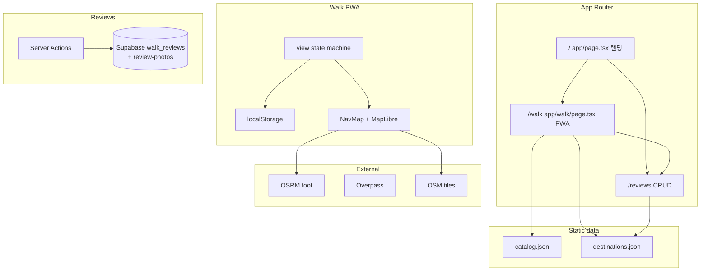
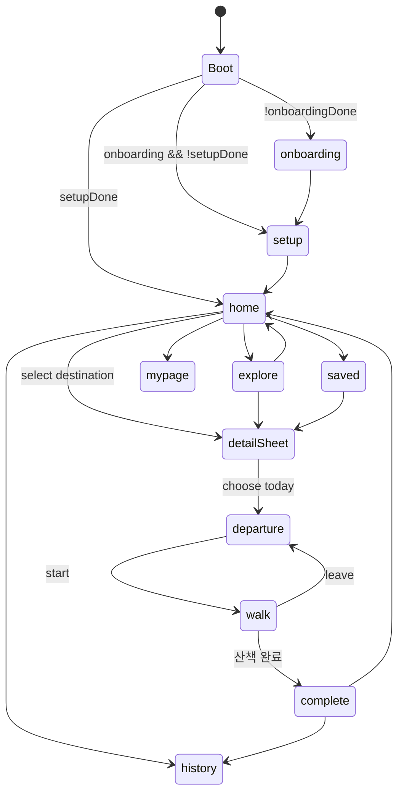
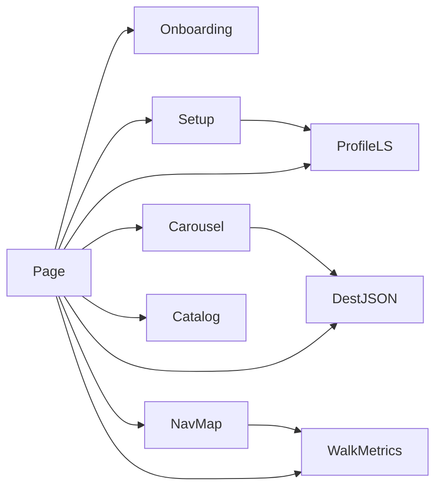

# ARCHITECTURE — 맘편한 산책 MVP

기술 구조만 기술한다. 제품 개요는 `PROJECT_CONTEXT.md` 참고.

---

## 전체 architecture



후기의 최종 저장소는 **Supabase**다. `/walk` 프로필·GPS 기록만 localStorage다. 호스팅은 **Vercel** (Next.js).

---

## Frontend 구조

| 레이어 | 역할 |
|--------|------|
| `app/layout.tsx` | HTML shell, metadata, Pretendard |
| `app/page.tsx` | 소개 랜딩 |
| `app/walk/page.tsx` | PWA 오케스트레이터 (`'use client'`) |
| `app/reviews/**` | 후기 목록/상세/등록/수정 |
| `app/components/landing` | 헤더·푸터·FAQ |
| `app/components/reviews` | 폼·카드·삭제 확인 |
| `app/components/ui` | shadcn 스타일 버튼/입력/다이얼로그 |
| `app/lib/review-actions.ts` | Server Actions CRUD |
| `public/` | PWA, 이미지, vendored MapLibre |

`NavMap`은 `next/dynamic(..., { ssr: false })`로 로드.

---

## Backend / API 구조

| 종류 | 존재 여부 |
|------|-----------|
| 자체 REST/GraphQL | 없음 |
| Server Actions | `createReview` / `updateReview` / `deleteReview` |
| DB | Supabase Postgres `walk_reviews` |
| Storage | Supabase `review-photos` |
| Auth / RLS | 미션 6에서는 사용자 인증 없음. 스키마는 RLS disable + 공개 정책 |

목적지 JSON은 서버가 읽기만 한다.

---

## 데이터 흐름

### 부트

1. `readProfile()` / saved / records / visits / complex 로드  
2. `onboardingDone` / `setupDone`에 따라 `view` 설정  
3. SW 등록, visit 카운트 +1  

### 추천 리스트

`destinations.json` → filter(complex, blocklist, category, ≤20min) → sort(straight_km) → home carousel / explore list.

### 경로

1. 사용자 출입구 선택 → `originPoint`  
2. `NavMap`이 OSRM `foot` 요청 (origin→destination만)  
3. `onRouteInfo`로 ETA/거리/좌표/hazard 카운트 반영  
4. Overpass로 경로 주변 steps/crossing 등 집계 (실패 시 0)  
5. 산책 중 GPS는 마커·헤딩·`remainingAlongRoute`만 갱신, **재라우팅 없음**

### 완료

`completeWalk` → records + validationLog localStorage → `view=complete` → review patch.

---

## State 흐름



주요 React state는 전부 `page.tsx`에 존재한다 (profile, view, complexId, category, selected, entranceId, saved, records, GPS/route 필드들).

전역 상태 라이브러리 없음. Context API 없음.

---

## Routing

- `/` 랜딩
- `/walk` PWA (`View` union + `?dev=1` HUD)
- `/reviews`, `/reviews/new`, `/reviews/[id]`, `/reviews/[id]/edit`
- `/reviews?q=&destination=&sort=&page=` 검색·필터·정렬

---

## Storage

| 메커니즘 | 용도 |
|----------|------|
| localStorage | `/walk` 프로필·저장·기록·단지·방문·검증로그 |
| Supabase | 산책 후기 본문·별점·사진 경로 |
| Cache API (SW) | `/walk` 정적 자산 |
| 서버 세션/쿠키 | 사용 안 함 |

---

## 외부 API

| Endpoint | 용도 | 인증 |
|----------|------|------|
| `https://router.project-osrm.org/route/v1/foot/{lon},{lat};{lon},{lat}?overview=full&geometries=geojson` | 도보 경로 | 없음 (공개) |
| `https://overpass-api.de/api/interpreter` | 경로 주변 hazard | 없음 |
| `https://tile.openstreetmap.org/{z}/{x}/{y}.png` | 지도 타일 | 없음 |
| `cdn.jsdelivr.net/.../pretendard.min.css` | 폰트 | 없음 |

후기 CRUD는 `NEXT_PUBLIC_SUPABASE_URL`, `NEXT_PUBLIC_SUPABASE_ANON_KEY`가 필요하다. 값은 `.env.local` / Vercel에만 두고 GitHub에 올리지 않는다.

---

## Dependency 관계

```
page.tsx
  ├─ OnboardingSlides
  ├─ SetupForm ── profile types
  ├─ RecommendCarousel ── profile helpers (amenities/tip/kind)
  ├─ NavMap (dynamic)
  │     └─ walkMetrics.fetchStrollerRoute / MapLibre vendor
  ├─ walkMetrics (ETA, blocklist, remainingAlongRoute, nextTurnHint)
  ├─ profile (read/write)
  ├─ catalog.json, destinations.json
  └─ globals.css (via layout)
```

npm runtime: `next`, `react`, `react-dom`만. MapLibre는 `/public/vendor` 스크립트.

---

## 핵심 component 관계



- **OnboardingSlides**: presentational, `onDone`
- **SetupForm**: controlled local form → `onSubmit(UserProfile)`
- **RecommendCarousel**: destinations + select / see all
- **NavMap**: `mode: preview | navigate`, origin/destination/current/heading, `onRouteInfo`

---

## Build / Deploy pipeline

```sh
pnpm dev
pnpm build && pnpm start
# 제출 배포: GitHub → Vercel (위 두 환경 변수 설정)
```

---

## 보안·프라이버시 (아키텍처 관점)

- 프로필·산책 기록은 **브라우저 로컬만**
- 위치는 기기 GPS → 클라이언트 처리; 자체 서버로 전송하는 코드 없음
- 경로 요청은 OSRM/Overpass로 좌표가 나갈 수 있음 (공개 엔드포인트)
- 문서/로그에 시크릿을 넣지 말 것; 현재 앱 코드에 API key 하드코딩 없음
